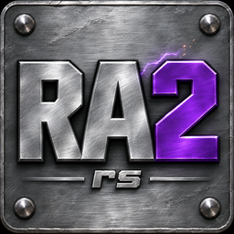

  

<h1 align="center">ra2-rs</h1>

**ra2-rs** is a ground-up Rust reimplementation of *Robot Arena 2: Design & Destroy* (2003). A new physics simulation and renderer bring the original robots, parts and arenas to Windows, Linux and macOS. Open a saved design in the workshop, change its wiring and take it into any of the five original Exhibition modes, from Deathmatch to King of the Hill.

Multiplayer was rebuilt from scratch. Your robot responds to your controls immediately, while the game smooths out movement between network updates. To play online, choose **Iroh native networking** and share the eight-digit room code with a friend. One player hosts the match, with no dedicated game server to run or ports to forward.

## Downloads

| Platform | v0.1.0-rc1 |
| --- | --- |
| Windows · x86-64 | [Download the executable](https://github.com/house-of-vanity/ra2-rs/releases/download/v0.1.0-rc1/ra2-rs-windows-x86_64.exe) |
| macOS · Apple Silicon | [Download the archive](https://github.com/house-of-vanity/ra2-rs/releases/download/v0.1.0-rc1/ra2-rs-macos-arm64.tar.gz) |
| Linux · x86-64 | [Download the archive](https://github.com/house-of-vanity/ra2-rs/releases/download/v0.1.0-rc1/ra2-rs-linux-x86_64.tar.gz) |

Unpack the archive on macOS or Linux. Place the executable next to `RA2.cfz` and `Components.cfz` in your existing game folder and launch it in place of the original game executable.

[All releases](https://github.com/house-of-vanity/ra2-rs/releases)
